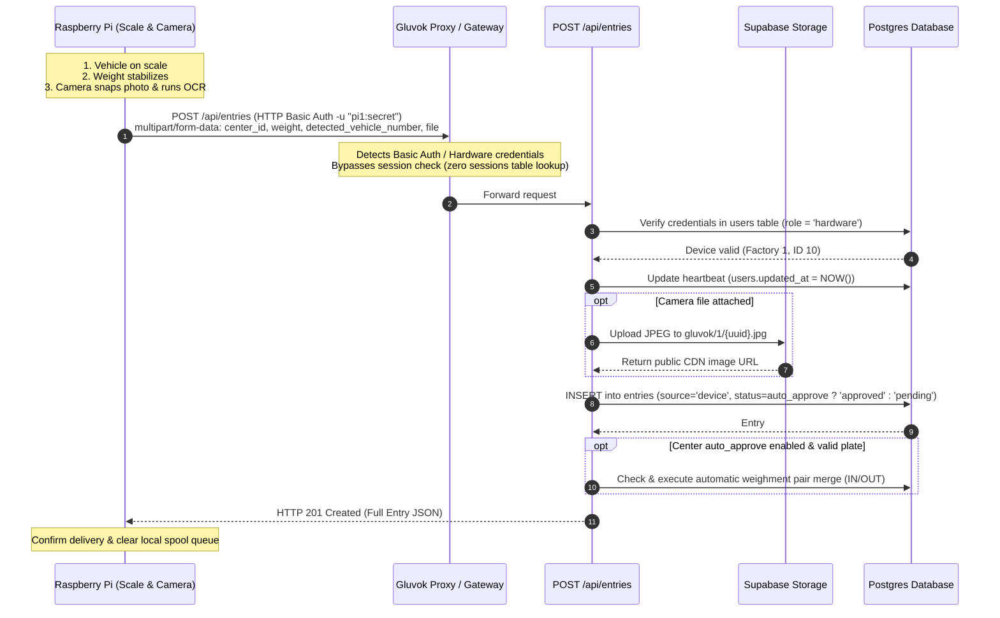

# Raspberry Pi cURL & Edge Integration Flow Guide

This guide details the exact architecture, end-to-end operational flow, and `curl` specifications for integrating edge devices (Raspberry Pi weighbridge scale indicators, IP ALPR cameras, or edge Python daemons) with the Gluvok platform.

---

## Quick Answer: Do We Need to Login First to Create a Session in the DB?

> [!IMPORTANT]
> **NO, you do NOT need to login first or create a session in the database.**
>
> Gluvok features **Stateless Per-Request Device Authentication** engineered specifically for edge IoT hardware. The Raspberry Pi supplies its hardware credentials directly with each weighment event using standard **HTTP Basic Auth** (`-u "username:password"`).
>
> The Next.js API proxy and route handler verify the credentials directly against the active `users` table (`role = 'hardware'`) on each request, touch the device's heartbeat timestamp (`users.updated_at`), and process the entry atomically—**without writing anything to the `sessions` table**.

### Why Stateless Direct Auth is the Proper Flow for Raspberry Pi:

1. **Zero Session Overhead & Lifecycle Management**: The Pi does not have to store tokens in RAM or flash, track token expiration, refresh tokens, or handle `401 Unauthorized` token expiry during a weighment event.
2. **Resilience to Power Cycles & Network Drops**: Factory weighbridges and rural yards often face power cuts or spotty internet. When power or connectivity is restored, the Pi immediately posts weighments without any authentication handshake or token negotiation.
3. **Zero Database Bloat**: Edge devices polling or cycling frequently do not pollute the `sessions` table with short-lived session records.

_(Note: If your edge architecture sits behind a centralized gateway that specifically requires token caching, the optional session bearer token flow via `POST /api/auth/login` is also supported as an alternative—see [Alternative Auth Methods](#alternative-authentication-methods).)_

---

## Table of Contents

1. [End-to-End Operational Lifecycle & Flow Diagram](#1-end-to-end-operational-lifecycle--flow-diagram)
2. [Step 1: One-Time Device Provisioning (Admin Setup)](#2-step-1-one-time-device-provisioning-admin-setup)
3. [Step 2: The Core Weighment Submission Flow (Recommended)](#3-step-2-the-core-weighment-submission-flow-recommended)
   - [Scenario A: Standard Weighment (Plate + Image + Weight)](#scenario-a-standard-weighment-plate--image--weight)
   - [Scenario B: Plate Unreadable Fallback (NO_PLATE_DETECTED)](#scenario-b-plate-unreadable-fallback-no_plate_detected)
   - [Scenario C: Weight Only (No Camera Image)](#scenario-c-weight-only-no-camera-image)
   - [Scenario D: Multi-Camera Views (Front + Overhead/Rear)](#scenario-d-multi-camera-views-front--overheadrear)
4. [Step 3: Server Processing Pipeline & Response Specification](#4-step-3-server-processing-pipeline--response-specification)
5. [Step 4: Alternative Authentication Methods](#5-step-4-alternative-authentication-methods)
6. [Step 5: Production-Ready Edge Scripts for Raspberry Pi](#6-step-5-production-ready-edge-scripts-for-raspberry-pi)
   - [Bash Script (weighment_upload.sh)](#bash-script-weighment_uploadsh)
   - [Python Daemon with Offline Spool Queue (gluvok_edge_daemon.py)](#python-daemon-with-offline-spool-queue-gluvok_edge_daemonpy)
7. [Step 6: Error Handling & Troubleshooting Reference](#7-step-6-error-handling--troubleshooting-reference)

---

## 1. End-to-End Operational Lifecycle & Flow Diagram

The complete hardware flow follows a 1-step atomic lifecycle:



---

## 2. Step 1: One-Time Device Provisioning (Admin Setup)

Each hardware device (Raspberry Pi, weighbridge indicator, or camera controller) is provisioned in the `users` table with `role = 'hardware'` and scoped to its parent `factory_id`.

### Database Insertion (SQL)

Provision a device directly in the database:

```sql
-- Provision a new edge device for Factory 1
-- Fast SHA-256 hash or Argon2id hash are both supported by verifyDeviceRequest
INSERT INTO users (factory_id, username, password_hash, role, name)
VALUES (
  1,
  'pi1',
  encode(sha256('hardware123'::bytea), 'hex'),
  'hardware',
  'Weighbridge Scale 1'
);
```

> [!NOTE]
> **Least-Privilege Security**: Accounts with `role = 'hardware'` only have `entries:create = true` permissions in the RBAC matrix. They cannot read users, modify rates, view customer accounts, or delete records. If a device in the yard is physically compromised, it cannot read sensitive business data.

---

## 3. Step 2: The Core Weighment Submission Flow (Recommended)

When a truck arrives at the weighbridge:

1. The scale indicator stabilizes the weight measurement (e.g. `18540.5` kg).
2. The camera captures an image and the ALPR algorithm extracts the plate (or falls back to `NO_PLATE_DETECTED`).
3. The Raspberry Pi fires a **single atomic `POST` request** to `/api/entries`.

### Request Specification

- **URL**: `https://gluvok.vercel.app/api/entries` (or `http://localhost:3000/api/entries` in dev)
- **Method**: `POST`
- **Content-Type**: `multipart/form-data`
- **Authentication**: HTTP Basic Auth (`-u "username:password"`)
- **Required Fields**:
  - `center_id` (integer): ID of the physical collection center where the scale is located.
  - `weight` (number): Gross or tare weight measured by the scale indicator (> 0).
  - `detected_vehicle_number` (string): Vehicle registration plate detected by camera (e.g. `MH12AB1234`), or `"NO_PLATE_DETECTED"`.
- **Optional Fields**:
  - `file` or `files` (binary): Camera snapshot (`image/jpeg`, `image/png`, or `image/webp`). Up to 10MB.

---

### Scenario A: Standard Weighment (Plate + Image + Weight)

The standard automated entry when the plate is clearly detected:

```bash
curl -X POST "https://gluvok.vercel.app/api/entries" \
  -u "pi1:hardware123" \
  -F "center_id=1" \
  -F "detected_vehicle_number=MH12AB1234" \
  -F "weight=18540.5" \
  -F "file=@/home/pi/captures/truck_001.jpg;type=image/jpeg"
```

---

### Scenario B: Plate Unreadable Fallback (`NO_PLATE_DETECTED`)

When dirt, lighting, or obstruction prevents plate detection, the hardware passes `NO_PLATE_DETECTED`. The system accepts the weighment, uploads the snapshot, but marks the entry `status = "pending"` for human operator review in the dashboard:

```bash
curl -X POST "https://gluvok.vercel.app/api/entries" \
  -u "pi1:hardware123" \
  -F "center_id=1" \
  -F "detected_vehicle_number=NO_PLATE_DETECTED" \
  -F "weight=18540.5" \
  -F "file=@/home/pi/captures/truck_obscured.jpg;type=image/jpeg"
```

---

### Scenario C: Weight Only (No Camera Image)

If the scale unit does not have a camera attached or the camera feed is offline, post the weight reading without a file:

```bash
curl -X POST "https://gluvok.vercel.app/api/entries" \
  -u "pi1:hardware123" \
  -F "center_id=1" \
  -F "detected_vehicle_number=MH12AB1234" \
  -F "weight=18540.5"
```

---

### Scenario D: Multi-Camera Views (Front + Overhead/Rear)

If the weighbridge has multiple cameras (e.g., front plate camera and overhead cargo camera), attach both files in the same multipart request:

```bash
curl -X POST "https://gluvok.vercel.app/api/entries" \
  -u "pi1:hardware123" \
  -F "center_id=1" \
  -F "detected_vehicle_number=MH12AB1234" \
  -F "weight=18540.5" \
  -F "files=@/home/pi/captures/front_plate.jpg;type=image/jpeg" \
  -F "files=@/home/pi/captures/cargo_top.jpg;type=image/jpeg"
```

---

## 4. Step 3: Server Processing Pipeline & Response Specification

### Backend Execution Sequence

When the server receives the `POST /api/entries` request from the Pi:

1. **Stateless Credential Verification**: Checks the `users` table for `username` and `role = 'hardware'`. Compares password hash (Argon2id or fast SHA-256).
2. **Heartbeat Touch**: Touches `users.updated_at = NOW()` to log device connectivity.
3. **Storage Upload**: Uploads attached images directly to the factory storage bucket (`gluvok/{factory_id}/...`) and retrieves public CDN URLs.
4. **Validation**: Validates Indian registration format (`MH12AB1234`) and weight positivity via Zod schema (`addDeviceEntrySchema`).
5. **Auto-Approval Rule**:
   - If the center has `auto_approve: true` and the plate was detected, `status` becomes `"approved"` and `approved_by` is set to the device ID.
   - If `detected_vehicle_number = "NO_PLATE_DETECTED"`, auto-approval is disabled and `status` is set to `"pending"`.
6. **Compensating Rollback**: If database insertion fails, any uploaded image files are automatically deleted from storage to prevent orphaned assets.
7. **Automatic Weighment Pair Merge**: If approved, the backend checks for matching IN/OUT entries for this vehicle and automatically creates/completes a weighment ticket.

### Expected Success Response (`201 Created`)

```json
{
  "data": {
    "id": 42,
    "detected_vehicle_number": "MH12AB1234",
    "vehicle_number": "MH12AB1234",
    "weight": 18540.5,
    "center_id": 1,
    "customer_id": null,
    "factory_id": 1,
    "created_by": 10,
    "approved_by": 10,
    "status": "approved",
    "auto_approved": true,
    "source": "device",
    "images": [
      "https://your-supabase-project.supabase.co/storage/v1/object/public/gluvok/1/abc123-1725210000.jpg"
    ],
    "created_at": "2026-09-19T10:30:00.000Z",
    "updated_at": "2026-09-19T10:30:00.000Z"
  }
}
```

---

## 5. Step 4: Alternative Authentication Methods

While HTTP Basic Auth (`-u`) is the recommended standard, Gluvok supports three alternative authentication methods:

### Method B: Custom Headers (`x-username` / `x-password`)

```bash
curl -X POST "https://gluvok.vercel.app/api/entries" \
  -H "x-username: pi1" \
  -H "x-password: hardware123" \
  -F "center_id=1" \
  -F "detected_vehicle_number=MH12AB1234" \
  -F "weight=18540.5" \
  -F "file=@/home/pi/captures/truck_001.jpg;type=image/jpeg"
```

### Method C: Form-Data Credentials

Include credentials directly inside the multipart form fields:

```bash
curl -X POST "https://gluvok.vercel.app/api/entries" \
  -F "username=pi1" \
  -F "password=hardware123" \
  -F "center_id=1" \
  -F "detected_vehicle_number=MH12AB1234" \
  -F "weight=18540.5" \
  -F "file=@/home/pi/captures/truck_001.jpg;type=image/jpeg"
```

### Method D: Optional Session Bearer Token (Gateway Pattern)

If an edge gateway caches tokens across multiple local sub-devices, you can create a session in the database by calling `/api/auth/login` once:

```bash
# 1. Login to obtain session token (writes a record to `sessions` table)
TOKEN=$(curl -s -X POST "https://gluvok.vercel.app/api/auth/login" \
  -H "Content-Type: application/json" \
  -d '{"username": "pi1", "password": "hardware123"}' \
  | jq -r '.token')

# 2. Make authenticated API call using Bearer token
curl -X POST "https://gluvok.vercel.app/api/entries" \
  -H "Authorization: Bearer $TOKEN" \
  -F "center_id=1" \
  -F "detected_vehicle_number=MH12AB1234" \
  -F "weight=18540.5" \
  -F "file=@/home/pi/captures/truck_001.jpg;type=image/jpeg"
```

---

## 6. Step 5: Production-Ready Edge Scripts for Raspberry Pi

### Bash Script (`weighment_upload.sh`)

A drop-in bash script with HTTP status validation and error logging:

```bash
#!/usr/bin/env bash
# Usage: ./weighment_upload.sh <center_id> <plate_or_NO_PLATE_DETECTED> <weight> <image_path>
set -euo pipefail

API_URL="${GLUVOK_API_URL:-https://gluvok.vercel.app/api/entries}"
DEVICE_USER="${GLUVOK_DEVICE_USER:-pi1}"
DEVICE_PASS="${GLUVOK_DEVICE_PASS:-hardware123}"

CENTER_ID="${1:-1}"
PLATE="${2:-NO_PLATE_DETECTED}"
WEIGHT="${3:-0}"
IMAGE_PATH="${4:-}"

CURL_ARGS=(
  -s -S
  -w "\n%{http_code}"
  -X POST "$API_URL"
  -u "${DEVICE_USER}:${DEVICE_PASS}"
  -F "center_id=${CENTER_ID}"
  -F "detected_vehicle_number=${PLATE}"
  -F "weight=${WEIGHT}"
)

if [[ -n "$IMAGE_PATH" && -f "$IMAGE_PATH" ]]; then
  CURL_ARGS+=(-F "file=@${IMAGE_PATH};type=image/jpeg")
fi

RESPONSE=$(curl "${CURL_ARGS[@]}")
HTTP_CODE=$(echo "$RESPONSE" | tail -n1)
BODY=$(echo "$RESPONSE" | sed '$d')

if [[ "$HTTP_CODE" == "201" ]]; then
  echo "[SUCCESS] Entry posted successfully: $BODY"
  exit 0
else
  echo "[ERROR] Failed to post entry (HTTP $HTTP_CODE): $BODY" >&2
  exit 1
fi
```

---

### Python Daemon with Offline Spool Queue (`gluvok_edge_daemon.py`)

In real-world weighbridge deployments, internet connectivity can be intermittent. The following Python daemon uses **Stateless HTTP Basic Auth** and includes an **offline SQLite buffer**. If the network goes down, weighments are spooled locally and automatically retried when connection restores—ensuring **zero data loss**:

```python
#!/usr/bin/env python3
"""
Gluvok Edge Weighbridge Daemon
Listens for scale/camera events, posts via HTTP Basic Auth, and handles offline queuing.
"""

import os
import time
import sqlite3
import requests
from pathlib import Path

API_URL = os.getenv("GLUVOK_API_URL", "https://gluvok.vercel.app/api/entries")
DEVICE_USER = os.getenv("GLUVOK_DEVICE_USER", "pi1")
DEVICE_PASS = os.getenv("GLUVOK_DEVICE_PASS", "hardware123")
DB_PATH = Path("/home/pi/gluvok_spool.db")

def init_spool_db():
    with sqlite3.connect(DB_PATH) as conn:
        conn.execute("""
            CREATE TABLE IF NOT EXISTS spool (
                id INTEGER PRIMARY KEY AUTOINCREMENT,
                center_id INTEGER NOT NULL,
                detected_vehicle_number TEXT NOT NULL,
                weight REAL NOT NULL,
                image_path TEXT,
                created_at TIMESTAMP DEFAULT CURRENT_TIMESTAMP
            )
        """)

def send_entry(center_id: int, plate: str, weight: float, image_path: str = None) -> bool:
    """Sends a single weighment using Stateless HTTP Basic Auth (No login required)."""
    data = {
        "center_id": str(center_id),
        "detected_vehicle_number": plate,
        "weight": str(weight),
    }
    files = {}
    if image_path and os.path.isfile(image_path):
        files["file"] = ("capture.jpg", open(image_path, "rb"), "image/jpeg")

    try:
        response = requests.post(
            API_URL,
            auth=(DEVICE_USER, DEVICE_PASS),  # HTTP Basic Auth natively verified by server
            data=data,
            files=files if files else None,
            timeout=15,
        )
        if response.status_code == 201:
            print(f"[OK] Entry recorded: {response.json().get('data', {}).get('id')}")
            return True
        else:
            print(f"[FAIL] Server responded with {response.status_code}: {response.text}")
            return False
    except requests.RequestException as e:
        print(f"[OFFLINE] Network error ({e}). Queuing entry locally.")
        return False
    finally:
        if "file" in files:
            files["file"][1].close()

def queue_entry(center_id: int, plate: str, weight: float, image_path: str = None):
    """Saves entry to local SQLite database when offline."""
    with sqlite3.connect(DB_PATH) as conn:
        conn.execute(
            "INSERT INTO spool (center_id, detected_vehicle_number, weight, image_path) VALUES (?, ?, ?, ?)",
            (center_id, plate, weight, image_path),
        )
    print(f"[QUEUED] Saved entry locally for later synchronization.")

def flush_spool_queue():
    """Flushes queued entries when connection is restored."""
    with sqlite3.connect(DB_PATH) as conn:
        cursor = conn.execute("SELECT id, center_id, detected_vehicle_number, weight, image_path FROM spool ORDER BY id ASC LIMIT 10")
        rows = cursor.fetchall()

    for row_id, center_id, plate, weight, img_path in rows:
        if send_entry(center_id, plate, weight, img_path):
            with sqlite3.connect(DB_PATH) as conn:
                conn.execute("DELETE FROM spool WHERE id = ?", (row_id,))
            time.sleep(0.5)
        else:
            break  # Still offline, wait for next flush cycle

def handle_weighment_event(center_id: int, plate: str, weight: float, image_path: str = None):
    """Main trigger called when scale reading stabilizes."""
    flush_spool_queue()
    if not send_entry(center_id, plate, weight, image_path):
        queue_entry(center_id, plate, weight, image_path)

if __name__ == "__main__":
    init_spool_db()
    # Example trigger simulation:
    print("Testing Gluvok edge ingestion flow...")
    handle_weighment_event(
        center_id=1,
        plate="MH12AB1234",
        weight=18540.5,
        image_path=None
    )
```

---

## 7. Step 6: Error Handling & Troubleshooting Reference

### HTTP Status Code Reference

| Status Code             | Meaning                | Root Cause                                                                                                                     | Actionable Resolution                                                                                    |
| :---------------------- | :--------------------- | :----------------------------------------------------------------------------------------------------------------------------- | :------------------------------------------------------------------------------------------------------- |
| `201 Created`           | Success                | Entry created and image uploaded                                                                                               | Entry successfully recorded. Spool cleared.                                                              |
| `400 Bad Request`       | Validation Failure     | Invalid plate format (not Indian plate & not `NO_PLATE_DETECTED`), negative weight (`weight <= 0`), or nonexistent `center_id` | Check validation errors in JSON response (`parsed.error`). If plate OCR fails, send `NO_PLATE_DETECTED`. |
| `401 Unauthorized`      | Missing Credentials    | Request sent without Basic Auth (`-u`), headers, or token                                                                      | Supply `-u "username:password"` in the `curl` invocation.                                                |
| `403 Forbidden`         | Authentication Failure | Invalid password, or device record has `deleted_at IS NOT NULL`                                                                | Verify credentials against `users` table where `role = 'hardware'`. Confirm device is not deactivated.   |
| `415 Unsupported Media` | Invalid Content-Type   | Payload was sent as `application/json` instead of `multipart/form-data`                                                        | Use `curl -F` (multipart) instead of `curl -d` (raw JSON). Multipart is required for file uploads.       |
| `500 Server Error`      | Backend Failure        | Database connection or Supabase Storage bucket timeout                                                                         | Queue entry in local spool and retry with exponential backoff.                                           |

---

### Device Health & Heartbeat Monitoring

Whenever a Raspberry Pi posts an entry (or attempts authentication), the backend updates `users.updated_at = NOW()`.

Factory administrators can verify whether a physical weighbridge scale is online by querying:

```sql
SELECT id, username, name, updated_at,
       (updated_at > NOW() - INTERVAL '5 minutes') AS is_online
FROM users
WHERE role = 'hardware' AND factory_id = 1;
```
